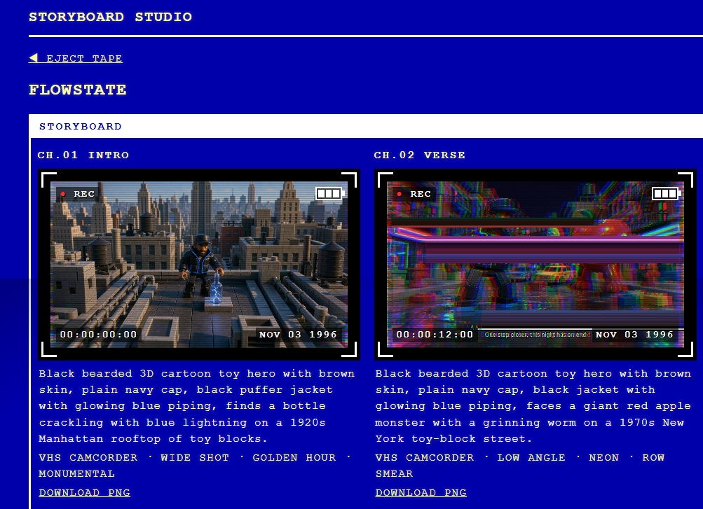

# Storyboard Studio

An open-source rebuild of Higgsfield's Cinema Studio, aimed at **music videos**. Create a storyboard for a song, add one frame per section (intro, verse, hook, bridge, outro), pick a camera, shot, lighting and direction preset, and get a generated still for each frame. The result is a storyboard row plus a downloadable shot list (CSV). The interface is styled like a 1990s VHS camcorder.

Built for the ComfyUI "Open Source Higgsfield" Build Night. **#OpenSourceHiggsfield**

> Status: generates real frames with **FLUX 3** (`bfl/flux-3-image`) through the **Comfy Router**. A mock generator (placeholder frames) is the default, so the app also runs without an API key.



## Setup (Windows PowerShell)

```powershell
python -m venv .venv
.venv\Scripts\python -m pip install -r requirements.txt
Copy-Item .env.example .env
.venv\Scripts\python -m flask --app app run
```

Then open http://127.0.0.1:5000. You don't need to activate the venv; calling `.venv\Scripts\python` directly avoids PowerShell execution-policy issues.

Dependencies are pinned in `requirements.txt`. That includes **numpy**, which the Glitch FX use for pixel work; it is installed by the command above.

## Direction and Glitch FX

Two optional groups sit beside camera, shot and lighting. Both default to **None**, which leaves a frame exactly as before.

**Direction** adds composition, lighting and mood wording to the prompt, so it shapes what the generator draws:

- **Monumental**: centered subject, huge scale, deep staging, cool muted tones.
- **One-Point Symmetry**: one-point perspective, mirrored composition, still and cold.
- **Warm Intimate**: close framing, warm practical light, rich skin tones.

**Glitch FX** are real pixel post-processing applied to the image *after* it is generated. They never touch the prompt, and each frame's effect is seeded from its id, so a frame always gets the same glitch.

- **Smear and stretch**: Row Smear (sideways bands), Sky Smear (the same, bright areas only), Burst (radial stretch from the center).
- **Color and optics**: Prism Zoom (radial blur with split color channels).
- **Signal and tape**: Signal Drip (bright pixels melt downward), Band Shift (bands slide left and right), Tape Decay (compression blocks, posterize, faint ghost).

## Running tests

```powershell
.venv\Scripts\python -m pytest -v
```

No test touches the network or reads your `.env`.

## Switching to the Comfy generator

You need a Comfy API key from a workspace that has credits (create one at platform.comfy.org). Edit `.env`:

```
GENERATOR=comfy
COMFY_API_KEY=your-key-here
```

The Comfy generator sends each frame's prompt to `bfl/flux-3-image` through the Comfy Router, downloads the result right away, and saves it as a PNG. If a request fails (bad key, no credits, moderation, timeout), the app shows "Image generation failed" and saves nothing. Never commit `.env`.

## Roadmap

- Animate storyboard frames into short clips
- Configurable model choice
- Audio analysis

## Project structure

```
app/
  __init__.py      create_app(config=None) factory
  routes.py        thin Flask routes
  storage.py       all file reads/writes and id/filename validation
  presets.py       sections, cameras, shots, lighting, direction, glitch FX
  fx.py            Glitch FX pixel post-processing (numpy)
  display.py       viewfinder text: timecode, date stamp, channel label
  prompt.py        build_prompt(...) pure function
  generators/      ImageGenerator base, MockGenerator, ComfyGenerator (Comfy Router, FLUX 3)
  templates/       Jinja templates (inline CSS, no JavaScript)
docs/              README screenshot
tests/             pytest suite
workflows/         not used: the Router calls the model directly, so no workflow file is needed
data/              storyboards on disk (created at runtime, git-ignored)
```

## License

MIT. See [LICENSE](LICENSE).